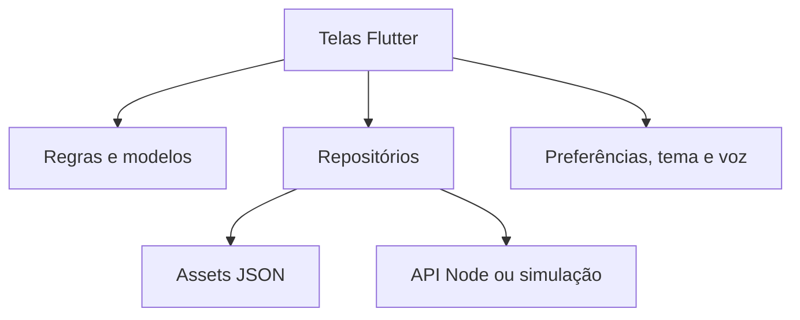

# Documentação técnica — Acessa+

Equipe Charmander · HackaRun 2026 · Revisão 14/11/2026  
Base: 0500d9d, integrada à main por 54786c3.

## Projeto e objetivo

O Acessa+ reduz barreiras para visitantes de shopping centers que precisam de outras formas de ler, se comunicar, se orientar ou solicitar ajuda. Destina-se a pessoas cegas, com baixa visão, surdas, com dificuldades de fala, mobilidade reduzida, sensibilidades sensoriais, idosos e estrangeiros.

O visitante combina recursos sem declarar diagnóstico. Os pilares são Comunicação Universal, Navegação Viva e Ajuda+. O MVP usa um shopping fictício e informa as simulações.

## Tecnologias

| Tecnologia | Versão declarada ou identificada | Função |
|---|---|---|
| Flutter | 3.47.5 identificado no ambiente | Interface Android, iOS e web |
| Dart | 3.13.4; restrição ^3.13.4 | Regras, modelos e telas |
| shared_preferences | ^2.5.6 | Preferências e idioma locais |
| flutter_tts | ^4.2.5 | Síntese de voz conforme dispositivo |
| http | ^1.5.0 | API de ocorrências |
| cupertino_icons | ^1.0.8 | Ícones |
| flutter_test / flutter_lints | SDK / ^6.0.0 | Testes e análise |
| JSON | Assets e arquivo do servidor | Catálogo, frases, percursos e ocorrências |
| Node.js | 18+ para servidor e testes | API demonstrativa e arquivos web |
| Fredoka / Atkinson Hyperlegible | Empacotadas com licenças | Tipografia |
| Git / GitHub | Repositório público | Histórico, fonte e entrega |
| Vercel | Configuração estática incluída | Hospedagem do build web |
| Trello | Organização descrita nos documentos originais | Gestão da equipe |

pubspec.lock registra a resolução das dependências. Diretórios de plataforma não comprovam teste em todos os sistemas. Spring Boot e PostgreSQL são evoluções futuras; a API existente é Node demonstrativa.

## Arquitetura

Organização por funcionalidades, modelos/regras, repositórios e componentes compartilhados.

| Diretório | Responsabilidade |
|---|---|
| app/lib/app/ | Aplicação, rotas, tema e i18n |
| app/lib/core/ | Widgets e síntese de voz |
| app/lib/domain/ | Modelos, rotas, viagens, procura e ocorrências |
| app/lib/data/ | JSON, contratos e clientes HTTP/simulados |
| app/lib/features/ | Preferências, destino, navegação, comunicação, ajuda, último metro e alertas |
| app/assets/ | Dados fictícios e fontes |
| app/test/ | Testes unitários e de widgets |
| .claude/serve-web.js | Build web e API na mesma origem |
| .claude/api-ocorrencias.js | API demonstrativa |
| docs/ | Documentação e propostas históricas |

PreferencesController e AlertasController usam ChangeNotifier; escopos expõem estado e dados às telas. Interações de tela mantêm estado local. Não há Provider, Riverpod ou Bloc.

## Inicialização e funcionamento

main restaura preferências, carrega o shopping e escolhe o repositório de alertas. O endereço vem de OCORRENCIAS_API; sem configuração, a web tenta /api/ocorrencias na mesma origem. Sem resposta saudável, usa simulação local identificada.

O visitante ajusta preferências, busca destino e planeja até cinco paradas. Cartões de comunicação e Ajuda+ também têm acesso no início e no percurso.

### Rotas e mapa

Dijkstra calcula menor custo em um grafo com 31 pontos, 22 locais e 36 trechos. Sem escadas remove trechos marcados. Preferência por elevador e redução de estímulos penalizam custos, sem garantia absoluta de exclusão. Paradas seguem a ordem escolhida, não uma otimização automática.

A distância exibida soma metros cadastrados. O tempo usa 50 metros/minuto com mínimo de um minuto. Ponto atual e direção são simulados; não há GPS indoor, sensor magnético ou BLE físico.

Chegadas avançam pelo botão de simulação. Paradas intermediárias aguardam confirmação. Mapa oferece recursos de visualização e acompanha o piso do percurso.

### Comunicação e idiomas

Cartões usam frases pré-traduzidas em pt/en/es, idioma de quem lê, respostas por toque e frente a frente. Isso não é chat livre nem tradução automática.

A camada i18n traduz textos cadastrados e modelos variáveis; texto sem tradução retorna em português. Voz usa flutter_tts e depende do motor do dispositivo/navegador. Orientação automática respeita preferência; ação explícita “Ouvir” pode solicitar fala diretamente. Texto permanece disponível.

### Ajuda+

Categoria, localização confirmável, preferência de atendimento e detalhes opcionais antecedem revisão e envio demonstrativo. Estados: registrada, atribuída, apoio a caminho e concluída, com cancelamento enquanto permitido. Nenhum funcionário real é acionado.

### Último metro

Cena fixa e direção controlada simulam localizar objetos por sinais visuais e hápticos. Não existe captura de câmera, OCR ou reconhecimento real de objetos.

### Mapa colaborativo

Relatos incluem piso, posição e categoria, como piso molhado, obstáculo, passagem interditada ou elevador parado. É possível confirmar permanência e votar em resolução. Expiração, duplicidade e impacto nos trechos são regras do domínio.

Alertas ativos afetam as rotas conforme categoria/proximidade e restrições, preservando escolhas de mobilidade. Não equivalem a informação oficialmente validada pelo shopping.

Em modo HTTP, sessões consultam a API a cada três segundos. Não há WebSocket. Em simulação, os dados não são compartilhados entre aparelhos.

## Contrato da API demonstrativa

| Método | Caminho | Finalidade |
|---|---|---|
| GET | /api/ocorrencias/saude | Saúde |
| GET | /api/ocorrencias?shopping=demo | Lista |
| POST | /api/ocorrencias | Registrar ou identificar duplicidade |
| POST | /api/ocorrencias/{id}/confirmar | Confirmar permanência |
| POST | /api/ocorrencias/{id}/resolver | Votar em resolução |

X-Sessao identifica uma sessão para controle de votos, sem autenticar uma pessoa. Respostas usam ocorrencia/ocorrencias; erros têm campo erro. O código do servidor é a referência completa de validações e limites.

Servidor salva .claude/dados/ocorrencias.json, fora do Git. Não há autenticação, moderação ou arquitetura de produção; não deve ser exposto como serviço operacional.

## Dados e privacidade

Catálogo, trechos e frases são assets. Preferências/idioma persistem no dispositivo; percurso e pedido de ajuda ficam em memória. Ocorrências compartilhadas vão ao servidor configurado. Portanto, a afirmação de que “nada sai do dispositivo” não se aplica aos relatos em modo compartilhado.

Não há cadastro obrigatório. Use somente dados fictícios na demonstração e evite informações pessoais em descrições. Dado ausente não comprova acessibilidade.

## Execução, qualidade e limites

Consulte [instalação e execução](desenvolvimento/execucao.md), [entrega final](../ENTREGA_FINAL.md) e [resultados de validação](qa/validacao-entrega-final.md).

O build estático não cria a API Node; sem serviço separado, mantém modo local. Voz varia por plataforma. Câmera/OCR, Libras automática, equipe real e localização física não estão implementados. Compatibilidade assistiva requer avaliação com pessoas usuárias e tecnologias assistivas; não há certificação declarada.
