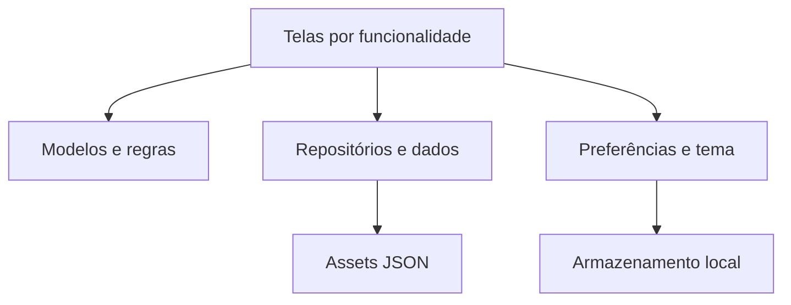

# Documentação técnica — Acessa+

**Equipe:** Charmander  
**Revisão:** 14/11/2026  
**Código de referência:** edbc8e9, incorporado à main por 4cb0ea1  
**Natureza:** MVP demonstrativo de hackathon

## 1. Projeto e problema

O Acessa+ busca reduzir barreiras de comunicação e orientação em shopping centers. Placas, mapas e atendimento exclusivamente verbal podem dificultar a visita de pessoas cegas, com baixa visão, surdas, com dificuldades de fala, mobilidade reduzida, sensibilidades sensoriais, idosos e estrangeiros.

A proposta permite que cada visitante escolha recursos úteis sem declarar deficiência ou diagnóstico. A experiência se organiza em três pilares: Comunicação Universal, Navegação Viva e Ajuda+.

## 2. Objetivo e escopo entregue

| Pilar ou módulo | Funcionamento no MVP |
|---|---|
| Preferências | Ajustes de leitura, contraste, movimento, comunicação e mobilidade, salvos no aparelho |
| Navegação Viva | Busca, rotas por pontos cadastrados, paradas e avanço por eventos BLE simulados |
| Comunicação Universal | Cartão de frases previamente traduzidas, respostas por toque e modo frente a frente |
| Ajuda+ | Seleção da necessidade, localização, forma de atendimento, revisão e estados simulados |
| Último metro | Exploração de uma cena fictícia para localizar objetos e demonstrar sinais visuais e hápticos |

O cartão não equivale a um chat livre. A assistência não envia mensagens para uma equipe real. A procura de objetos não utiliza câmera ou modelo de visão computacional.

## 3. Tecnologias utilizadas

Versões abaixo são restrições declaradas no pubspec da base publicada, não afirmações sobre a versão instalada em todos os ambientes.

| Tecnologia | Versão ou situação | Papel |
|---|---|---|
| Flutter | Versão do framework não fixada no repositório | Interface compartilhada e integração com plataformas |
| Dart | SDK ^3.13.4 | Modelos, regras, estado e telas |
| Material e Cupertino Icons | Flutter / cupertino_icons ^1.0.8 | Controles, navegação e ícones |
| shared_preferences | ^2.5.6 | Persistência local de idioma e preferências |
| JSON | Assets empacotados | Catálogo, trechos, frases e sugestões |
| Flutter Test | SDK Flutter | Testes unitários e de widgets |
| flutter_lints | ^6.0.0 | Análise estática |
| Fredoka / Atkinson Hyperlegible | Fontes locais, licenças em assets/fonts | Títulos e leitura |
| Git / GitHub | Repositório público | Histórico, branches e avaliação do fonte |
| HTML, CSS e JavaScript | Protótipo separado | Referência inicial de fluxos |
| Trello | Organização documentada | Planejamento e acompanhamento da equipe |

O projeto possui diretórios Android, iOS e web. Android é a prioridade móvel da proposta; a existência do diretório iOS não comprova teste nessa plataforma. VS Code, Android Studio e Figma são ferramentas previstas nos documentos originais, não dependências de execução.

Spring Boot e PostgreSQL são possibilidades futuras. Não existe API própria nem banco remoto no MVP publicado.

## 4. Arquitetura

A aplicação adota organização por funcionalidades, com componentes compartilhados, modelos, regras e repositórios. Não há servidor na arquitetura atual.



A figura resume relações de uso, não um isolamento completo de camadas: alguns modelos ainda importam o enum de idioma da feature de preferências.

| Diretório | Conteúdo e responsabilidade |
|---|---|
| app/lib/app/ | Aplicação, rotas, tema, tokens e política de movimento |
| app/lib/core/widgets/ | Botões, cartões, identidade e componentes compartilhados |
| app/lib/domain/models/ | Pontos, locais, trechos e conteúdos de comunicação |
| app/lib/domain/rules/ | Rotas, viagens, procura de objetos e assistência |
| app/lib/data/repositories/ | Contratos de acesso e leitura dos JSON |
| app/lib/data/shopping_data.dart | Carga do shopping e disponibilização por DadosScope |
| app/lib/features/welcome_preferences/ | Boas-vindas, ajustes e persistência |
| app/lib/features/destino/ | Pesquisa e planejamento com paradas |
| app/lib/features/navegacao/ | Orientação por etapas e mapa |
| app/lib/features/comunicacao/ | Cartão de ajuda e interações bilíngues |
| app/lib/features/ajuda/ | Formulário, revisão e acompanhamento |
| app/lib/features/ultimo_metro/ | Cena e procura demonstrativa |
| app/test/ | Testes de regras, dados e widgets |

A documentação detalhada está em [arquitetura atual](arquitetura/arquitetura-atual.md).

## 5. Inicialização e gerenciamento de estado

O main inicializa o Flutter, restaura preferências e carrega os dados. AcessaApp aplica tema, escala de texto e escopos de acesso ao estado.

PreferencesController utiliza ChangeNotifier e InheritedNotifier. DadosScope distribui o shopping já carregado. Busca, paradas, pedido e telas de navegação usam estado local; não foi adotado Provider, Riverpod ou Bloc.

EstadoNavegacao representa o progresso de forma imutável. O pedido de ajuda usa PedidoAjuda, com categoria, local, preferência, detalhes e estado. Não há restauração persistente de percurso ou pedido após fechar o app.

## 6. Funcionamento dos fluxos

### 6.1 Preferências e destino

O visitante pode abrir as preferências, combinar recursos e continuar para a busca. Comunicação Universal e Ajuda+ também têm atalhos na tela inicial.

Na busca, o visitante consulta locais, filtra resultados e altera o ponto atual simulado. A origem representa um ponto cadastrado, não a posição física do aparelho.

### 6.2 Cálculo e planejamento da rota

O catálogo contém 31 pontos e 22 locais; 36 trechos conectam pontos em três níveis fictícios. Dijkstra encontra o menor custo no grafo bidirecional.

“Sem escadas” remove trechos marcados com degraus. Preferir elevador multiplica por seis o custo de trocas de piso por escada ou escada rolante. Redução de estímulos multiplica por três o custo de trechos cadastrados com movimento alto. As preferências por custo não garantem exclusão absoluta desses trechos.

A interface permite até cinco paradas, com reordenação e remoção. O motor respeita a ordem escolhida; não otimiza automaticamente a sequência. Caso uma perna seja incompatível, informa qual parada falhou sem retirar as restrições do visitante.

Distâncias exibidas são a soma dos metros cadastrados, não do custo ponderado. Tempo estimado: 50 metros por minuto, com mínimo de um minuto.

### 6.3 Navegação Viva

Após iniciar, são apresentados etapa, ponto atual, progresso e distância restante. O visitante aciona “Simular chegada” para representar um evento de beacon. Uma parada intermediária aguarda confirmação antes da próxima perna.

Mapa e seta usam coordenadas ilustrativas. Rotação, zoom, piso e recentralização ajudam a visualizar o percurso, mas não correspondem a GPS indoor ou magnetômetro.

### 6.4 Cartão de comunicação

O visitante seleciona uma frase e o idioma de quem vai ler. O cartão apresenta o texto e permite respostas por toque. O modo frente a frente gira a metade destinada à outra pessoa.

Frases em português, inglês e espanhol são pré-traduzidas. Não há tradução livre automática. Quando existe destino, ele pode preencher uma frase contextual. Traduções precisam de revisão humana antes de uso operacional.

### 6.5 Ajuda+

O visitante seleciona uma categoria, confirma ou corrige o local, indica forma de atendimento e detalhes opcionais. Antes do envio demonstrativo, revisa os dados.

Estados: solicitação registrada, atendimento atribuído, apoio a caminho e concluída. Cancelamento é permitido enquanto o pedido está em andamento. As transições são controladas pela demonstração; nenhum funcionário é acionado. Quando aberto no percurso, o fluxo permite retornar à navegação preservada na pilha de telas.

### 6.6 Último metro

Ao chegar, o app oferece uma demonstração de procura de objetos. Um controle simula a direção; uma cena fixa determina quais objetos estariam no campo de visão. Indicadores e pulsos hápticos mudam conforme o alvo se aproxima do centro.

Não existe captura de imagem, OCR, detector real ou garantia de orientação física segura.

## 7. Dados, armazenamento e privacidade

| Dado | Local | Persistência |
|---|---|---|
| Pontos e locais | assets/data/catalogo.json | Empacotado no aplicativo |
| Trechos | assets/data/percursos.json | Empacotado no aplicativo |
| Frases e cartões | assets/data/comunicacao.json | Empacotado no aplicativo |
| Idioma e preferências | shared_preferences | Local, até exclusão |
| Percurso e pedido | Memória da sessão | Não restaurados ao reabrir |
| Cena de objetos | Regras de procura | Fictícia, definida no código |

Não há cadastro obrigatório, backend de usuários ou envio do pedido para fora do aparelho. Preferências representam escolhas de recursos. Campos livres podem conter texto informado pelo visitante e devem ser usados com dados fictícios durante a demonstração.

Informação não cadastrada aparece como “Não informado”, sem presumir acessibilidade. Consulte o [dicionário de dados](dados/dicionario-de-dados.md).

## 8. Execução e avaliação do fonte

```powershell
git clone https://github.com/luisacastro-max/Charmander.git
cd Charmander/app
flutter pub get
flutter run -d chrome
```

Para Android: executar flutter devices e usar flutter run -d com o identificador retornado. Para web de produção, executar flutter build web --release e servir app/build/web por HTTP.

Dependências estão em app/pubspec.yaml, com resolução versionada em app/pubspec.lock. Não são necessárias chaves de API ou servidor de banco para o MVP documentado.

## 9. Qualidade e testes

Executar flutter analyze e flutter test em app/. Os testes cobrem dados, preferências, rotas, viagens, destino, navegação, cartão, assistência e procura demonstrativa.

Arquivos .feature registram cenários BDD, mas não há runner Gherkin configurado. Testes de widgets e semântica não substituem uso com TalkBack/VoiceOver.

Esta revisão validou organização e documentação; não obteve nova execução aprovada do app. Na análise anterior, o ambiente bloqueou o lockfile do SDK. O [plano de validação](qa/plano-de-validacao.md) informa como registrar evidências sem presumir aprovação.

## 10. Limitações e evolução

Home completa, conversa livre, voz para texto, barreiras com rota alternativa, emergência e painel ainda requerem evolução no Flutter. OCR continua uma decisão pendente; “último metro” simulado não implementa OCR.

Síntese de voz com flutter_tts e internacionalização ampliada estavam em alterações locais não publicadas na base documentada. A cobertura de idioma, disponibilidade de vozes e suporte por dispositivo precisam de validação antes de apresentação como entrega.

Para operação real, será necessário validar dados, acessibilidade, infraestrutura BLE, integração com atendimento e tratamento de dados. O código demonstrativo não comprova segurança de navegação em um shopping real.
